<div align="center">

<a href="https://daniel-gomes.vercel.app/"></a>

<br/>

<a href="https://daniel-gomes.vercel.app/"></a>
<a href="https://www.linkedin.com/in/daniel-gomes-fullstack/"></a>
<a href="mailto:dg.contato.br@gmail.com"></a>
<a href="https://wa.me/5511992270266"></a>

<br/><br/>



<br/><br/>


## ⚔️ Missões

<a href="https://04sorteio.com.br"></a>&nbsp;<a href="https://animaqui.vercel.app"></a>
<br/>
<a href="https://senai-notes-xi.vercel.app/login"></a>&nbsp;<a href="https://ats-penetration.vercel.app"></a>
<br/>
<a href="https://github.com/gv5-assessoria"></a>&nbsp;<a href="https://github.com/dg-2025/Corrente-Agasalho"></a>
<br/>
&nbsp;
<br/>

## 🎒 Inventário


## 🏆 Conquistas

<a href="https://www.credly.com/badges/b70867ab-b194-497e-8447-c8ae91da1563"></a>
<a href="https://www.credly.com/badges/7ed23956-bcec-435e-b4f4-dca664a0a727"></a>
<a href="https://www.credly.com/badges/7a526d63-c6fa-4ff1-837b-754bdbfae2f9"></a>
<a href="https://www.credly.com/badges/882e5737-ab9b-415b-ba4b-ea62c535eb1f"></a>

## 🐍 Rastro no campo de batalha

<picture>
  <source media="(prefers-color-scheme: dark)" srcset="https://raw.githubusercontent.com/dg-2025/dg-2025/output/github-snake-dark.svg">
  <source media="(prefers-color-scheme: light)" srcset="https://raw.githubusercontent.com/dg-2025/dg-2025/output/github-snake.svg">
  
</picture>

<br/><br/>


<br/>


<br/><br/>

<details>
<summary><b>🐉 Não acorde o dragão</b></summary>

<br/>

```text
> o dragão abre um olho.
> ele pergunta se você testou em produção.
> você olha para o lado.
> ele volta a dormir. ele já sabe.
```

</details>

<br/>


<br/><br/>


</div>
